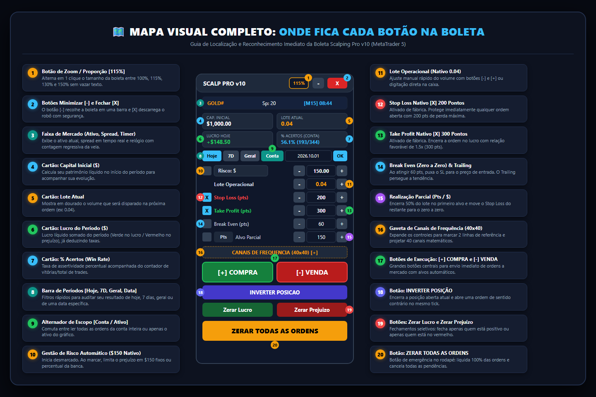

# 📘 Manual Oficial do Usuário e Guia Operacional Exaustivo
## Boleta Scalping Pro v10 — MetaTrader 5

Este documento é o manual oficial e minucioso da **Boleta Scalping Pro v10**. Ele detalha cada função, botão, campo de entrada, cálculo forense de assertividade, sistema de linhas dinâmicas 24/7 e projeção de canais de frequência simétrica.

---

## 🧭 Sumário das Seções
1. [Instalação e Carregamento no Terminal](#1-instalação-e-carregamento-no-terminal)
2. [Anatomia Visual da Interface](#2-anatomia-visual-da-interface)
3. [Cabeçalho, Zoom e Controles da Janela](#3-cabeçalho-zoom-e-controles-da-janela)
4. [Faixa de Mercado em Tempo Real (Market Strip)](#4-faixa-de-mercado-em-tempo-real-market-strip)
5. [Os 4 Cartões Centrais de Confiança (HUD Stats)](#5-os-4-cartões-centrais-de-confiança-hud-stats)
6. [Barra de Apuração Temporal & Alternador [Conta / Ativo]](#6-barra-de-apuração-temporal--alternador-conta--ativo)
7. [Gestão de Risco ($150 Nativo) e Lote Operacional (0.04)](#7-gestão-de-risco-150-nativo-e-lote-operacional-004)
8. [Alvos Nativos do Set: Stop Loss (200 pts) e Take Profit (300 pts)](#8-alvos-nativos-do-set-stop-loss-200-pts-e-take-profit-300-pts)
9. [Linhas Visuais Dinâmicas no Gráfico 24/7 (Bracket Móvel)](#9-linhas-visuais-dinâmicas-no-gráfico-247-bracket-móvel)
10. [Break Even e Trailing Stop Automáticos](#10-break-even-e-trailing-stop-automáticos)
11. [Realização Parcial Inteligente com Mover para Zero a Zero](#11-realização-parcial-inteligente-com-mover-para-zero-a-zero)
12. [Sugestão de Alvos Voláteis por ATR (Average True Range)](#12-sugestão-de-alvos-voláteis-por-atr-average-true-range)
13. [Gaveta de Canais de Frequência Manuais (40x40)](#13-gaveta-de-canais-de-frequência-manuais-40x40)
14. [Botões Operacionais de Execução e Emergência](#14-botões-operacionais-de-execução-e-emergência)
15. [Tabela Completa de Parâmetros de Entrada (.set)](#15-tabela-completa-de-parâmetros-de-entrada-set)

---

## 1. Instalação e Carregamento no Terminal

1. **Localização dos Arquivos**:
   - Binário compilado: `MQL5\Experts\Boleta\BoletaScalpingComCanaisV10.ex5`
   - Código-fonte: `MQL5\Experts\Boleta\BoletaScalpingComCanaisV10.mq5`
2. **Permissão de Trading**:
   - No menu superior do MetaTrader 5, certifique-se de que o botão **"Algo Trading"** esteja ativo (verde).
   - Ao arrastar a boleta para o gráfico, vá na aba **"Comum"** e marque **"Permitir Negociação Automatizada"**.
3. **Persistência de Estado (Memória Global)**:
   - Você pode trocar de tempo gráfico livremente (M1, M5, M15, H1). A boleta possui o módulo `SaveState()` e `LoadState()`, que memoriza os lotes, o zoom, a posição da janela e os canais traçados sem resetar nenhuma configuração.

---

## 2. Mapa Visual e Anatomia da Interface (Onde Fica Cada Botão)

Para total familiarização visual, consulte o infográfico mapeado abaixo com **20 pins numerados** identificando a posição exata de cada botão e mostrador:



### 📌 Tabela de Reconhecimento Rápido dos 20 Controles Numerados:

| Pin | Controle / Botão | Posição no Painel | Padrão Nativo | Função e Como Operar |
|:---:|:---|:---|:---:|:---|
| **1** | **Botão de Zoom [115%]** | Cabeçalho (Direita) | `115%` | Alterna instantaneamente o tamanho da boleta entre 100%, 115%, 130% e 150% sem vazar fontes. |
| **2** | **Minimizar `[-]` e Fechar `[X]`** | Canto Superior Direito | Ativos | `[-]` recolhe a boleta em uma barra compacta; `[X]` encerra o robô e limpa os objetos da tela. |
| **3** | **Faixa de Mercado (Strip)** | Abaixo do Cabeçalho | Automático | Exibe o símbolo ativo (ex: `GOLD#`), o **Spread real** e a contagem regressiva da vela `[M15] 08:44`. |
| **4** | **Cartão: Capital Inicial ($)** | HUD (Superior Esquerdo) | Dinâmico | Calcula o saldo com que você iniciou o período selecionado para medir sua evolução real. |
| **5** | **Cartão: Lote Atual** | HUD (Superior Direito) | `0.04` | Mostra em destaque dourado o volume que será enviado na próxima ordem de compra ou venda. |
| **6** | **Cartão: Lucro do Período ($)** | HUD (Inferior Esquerdo) | Dinâmico | Resultado líquido fechado já descontando swap e comissões (Verde no lucro, Vermelho no prejuízo). |
| **7** | **Cartão: % Acertos (Win Rate)** | HUD (Inferior Direito) | Dinâmico | Taxa percentual de acerto acompanhada do contador de vitórias e total de trades `(Vitórias/Total)`. |
| **8** | **Barra de Períodos Rápidos** | Centro Superior | `Hoje` | Botões `[Hoje]`, `[7D]`, `[Geral]` e campo de data personalizada (ex: `2026.10.01` + `[OK]`). |
| **9** | **Alternador de Escopo** | Barra de Períodos | `[Conta]` | Comuta a leitura do histórico entre **todos os ativos da conta** (`[Conta]`) ou **só o ativo do gráfico** (`[Ativo]`). |
| **10** | **Gestão de Risco Automático** | Linha de Risco | Desmarcado `[ ]` | Quando ativado `[X]`, calcula o lote automaticamente para limitar o risco em `$150.00` ou `%` da conta. |
| **11** | **Lote Operacional** | Linha de Lote | `0.04` | Ajuste manual rápido de lote via botões `[-]` e `[+]` ou digitação direta na caixa de texto. |
| **12** | **Stop Loss Nativo (pts)** | Linha de Proteção SL | Marcado `[X] 200` | Ativado de fábrica com **200 pontos**. Ajustável via `[-]` e `[+]` de 10 em 10 pontos. |
| **13** | **Take Profit Nativo (pts)** | Linha de Alvo TP | Marcado `[X] 300` | Ativado de fábrica com **300 pontos** (relação risco/retorno favorável de 1.5x). |
| **14** | **Break Even e Trailing Stop** | Linhas de Proteção Dinâmica | Desmarcados | `Break Even` puxa o SL para o preço de entrada aos 60 pts; `Trailing Stop` persegue a tendência a cada 2 pts. |
| **15** | **Realização Parcial Inteligente** | Linha de Parcial | Desmarcada | Encerra 50% da posição no primeiro alvo (`Pts` ou `$`) e pode mover o restante para o zero a zero. |
| **16** | **Gaveta de Canais 40x40** | Faixa Central Dourada | Recolhida `[+]` | Expande o painel para marcar 2 linhas de referência e projetar até 40 canais matemáticos no gráfico. |
| **17** | **Botões `[+] COMPRA` e `[-] VENDA`**| Área Central de Operação | Prontos | Grandes botões para envio imediato de ordens a mercado com alvos automáticos acoplados. |
| **18** | **Botão INVERTER POSIÇÃO** | Abaixo da Compra/Venda | Roxo Índigo | Liquida a posição atual e abre uma nova ordem de sentido oposto no mesmo tick sem delay. |
| **19** | **Zerar Lucro e Zerar Prejuízo** | Linha de Saída Seletiva | Prontos | Fechamentos cirúrgicos: encerra apenas as ordens positivas ou apenas as ordens perdedoras. |
| **20** | **ZERAR TODAS AS ORDENS** | Rodapé (Dourado Âmbar) | Emergência | Botão de pânico: encerra 100% das posições abertas na conta e cancela todas as ordens pendentes. |

```
+-------------------------------------------------------------+
| SCALP PRO v10                          [115%]  [-]  [X]     |  <- (1, 2) Cabeçalho & Zoom
+-------------------------------------------------------------+
| GOLD#                     Sp: 20             [M15] 08:44    |  <- (3) Faixa de Mercado
+------------------------------+------------------------------+
| CAP. INICIAL                 | LOTE ATUAL                   |  <- (4, 5) Cartões HUD Topo
| $1,000.00                    | 0.04                         |
+------------------------------+------------------------------+
| LUCRO HOJE                   | % ACERTOS (CONTA)            |  <- (6, 7) Lucro & Win Rate
| +$148.50                     | 56.1% (193/344)              |
+------------------------------+------------------------------+
| [Hoje]  [7D]  [Geral]  [Conta]  [2026.10.01]  [OK]          |  <- (8, 9) Barra de Datas & Escopo
+-------------------------------------------------------------+
| [ ] Risco: $                 [-]   150.00   [+]             |  <- (10) Gestão de Risco ($150)
|     Lote Operacional         [-]     0.04   [+]             |  <- (11) Lote Operacional (0.04)
+-------------------------------------------------------------+
| [X] Stop Loss (pts)          [-]      200   [+]             |  <- (12) Stop Loss Nativo 200
| [X] Take Profit (pts)        [-]      300   [+]             |  <- (13) Take Profit Nativo 300
| [ ] Break Even (pts)         [-]       60   [+]             |  <- (14) Break Even
| [ ] Trailing Stop (pts)      [-]      150   [+]             |  <- (14) Trailing Stop
+-------------------------------------------------------------+
| [ ] [Pts] Alvo Parcial       [-]      150   [+]             |  <- (15) Realização Parcial
|     Vol. Parcial (%)         [-]      50%   [+]             |
| [ ] Mover SL p/ Zero a Zero pós Parcial                     |
+-------------------------------------------------------------+
| CANAIS DE FREQUENCIA (40x40)  [+]                           |  <- (16) Gaveta de Canais
+------------------------------+------------------------------+
|        [+] COMPRA            |          [-] VENDA           |  <- (17) Execução Rápida
+------------------------------+------------------------------+
|                     INVERTER POSICAO                        |  <- (18) Inversão de Mão
+------------------------------+------------------------------+
|         Zerar Lucro          |        Zerar Prejuizo        |  <- (19) Fechamentos Seletivos
+-------------------------------------------------------------+
|                    ZERAR TODAS AS ORDENS                    |  <- (20) Pânico / Zera Tudo
+-------------------------------------------------------------+
```

---

## 3. Cabeçalho, Zoom e Controles da Janela

- **Botão de Zoom / Escala Visual (`Btn_Zoom`)**:
  - Exibe a porcentagem atual (ex: `[115%]`).
  - A cada clique, altera a escala instantaneamente em ciclo:
    $$\text{100\% (Compacta - 276px)} \longrightarrow \text{115\% (Confortável - 318px)} \longrightarrow \text{130\% (Grande - 360px)} \longrightarrow \text{150\% (Extra Grande - 414px)} \longrightarrow \text{100\%}$$
  - Todos os botões, fontes e caixas aumentam proporcionalmente sem vazar texto para fora.
- **Botão Minimizar (`[-] / [+]`)**:
  - Recolhe todo o corpo da boleta, mantendo apenas a barra de título no topo para economizar espaço de tela.
- **Botão Fechar (`[X]`)**:
  - Descarrega a boleta do gráfico e limpa todos os objetos visuais de forma segura.
- **Arrastar e Soltar (Drag & Drop)**:
  - Clique e segure no cabeçalho ou na faixa de mercado para mover a boleta para qualquer canto do gráfico.

---

## 4. Faixa de Mercado em Tempo Real (Market Strip)

1. **Ativo Operado**: Mostra o ticker do ativo no gráfico (ex: `GOLD#`, `BTCUSD#`).
2. **Spread em Tempo Real (`Sp: 20`)**: Diferença instantânea entre o preço de compra (Ask) e de venda (Bid). Essencial para saber se a corretora alargou o spread antes de disparar uma ordem.
3. **Relógio do Candle (`[M15] 08:44`)**: Contagem regressiva de minutos e segundos para o término da vela atual.

---

## 5. Os 4 Cartões Centrais de Confiança (HUD Stats)

1. **CAP. INICIAL**:
   - Saldo que você tinha na conta no início do período selecionado ($$Saldo Atual - Lucro do Período$$).
   - Serve de régua para verificar visualmente o crescimento patrimonial da conta.
2. **LOTE ATUAL**:
   - Destacado em dourado. Mostra com exatidão o lote que será enviado na próxima operação (ex: `0.04`).
3. **LUCRO DO PERÍODO**:
   - Lucro líquido acumulado no período (descontadas comissões e swaps).
   - Fica **Verde** em caso de lucro e **Vermelho** em caso de prejuízo.
4. **% ACERTOS (WIN RATE)**:
   - Taxa de acerto real em porcentagem, acompanhada do contador de vitórias e total de trades:
     $$\text{Win Rate \%} = \left(\frac{\text{Trades Vencedores}}{\text{Total de Trades Fechados}}\right) \times 100$$
   - Exemplo: `56.1% (193/344)` significa 193 vitórias em 344 operações encerradas.

---

## 6. Barra de Apuração Temporal & Alternador [Conta / Ativo]

- **Botão `[Conta]` / `[Ativo]` (Escopo)**:
  - `[Conta]` *(Padrão)*: Analisa o histórico de **todos** os ativos negociados na conta (Ouro, Bitcoin, Petróleo, Moedas, Índices).
  - `[Ativo]`: Ao clicar, filtra exclusivamente as operações do ativo do gráfico atual.
- **Filtros Rápidos de Data**:
  - `[Hoje]`: Ordens fechadas da meia-noite de hoje até o segundo presente.
  - `[7D]`: Últimos 7 dias corridos.
  - `[Geral]`: Todo o histórico registrado na conta desde o início.
- **Data Personalizada**:
  - Digite na caixa de texto a data inicial desejada (ex: `2026.10.01`) e clique em **[OK]**. A taxa de acerto e o lucro acumulado daquele período serão calculados imediatamente.
- **Tolerância a Fim de Semana**:
  - O MT5 costuma congelar a hora na sexta-feira em mercados como Ouro. A boleta utiliza marco temporal dinâmico para garantir que ordens de Bitcoin e criptos no sábado/domingo nunca sejam ignoradas.

---

## 7. Gestão de Risco ($150 Nativo) e Lote Operacional (0.04)

- **Modo Lote Fixo (Nativo)**:
  - O checkbox de risco inicia **desmarcado** `[ ]`.
  - A boleta opera rigorosamente com o lote digitado no campo **Lote Operacional** (padrão `0.04`).
  - Use os botões `[-]` e `[+]` para alterar o volume no menor incremento da corretora (0.01).
- **Modo Risco Automático [X]**:
  - Ao marcar a caixa `[X]`:
    - `Risco: $`: Define uma perda máxima em dólares (padrão `$150.00`). O robô calcula o lote ideal para que, se atingir o Stop Loss de 200 pontos, a perda seja de exatamente $150.
    - `Risco: %`: Define o risco em porcentagem do saldo da conta (ex: `1.0%`).
    - Clique no botão `Risco: $` para alternar entre dinheiro e porcentagem.

---

## 8. Alvos Nativos do Set: Stop Loss (200 pts) e Take Profit (300 pts)

- **Stop Loss [X] 200 Pontos**:
  - Inicia ativado de fábrica (`[X]`) com **200 pontos**.
  - Qualquer ordem aberta a mercado já é enviada à corretora com a proteção preenchida, blindando a conta contra quedas de internet ou energia.
- **Take Profit [X] 300 Pontos**:
  - Inicia ativado de fábrica (`[X]`) com **300 pontos** (Relação Risco:Retorno favorável de 1.5x).
  - Ao atingir os 300 pontos, a operação é encerrada com ganho automaticamente.
- Desmarcar o checkbox permite entrar sem alvos para quem opera saídas 100% manuais.

---

## 9. Linhas Visuais Dinâmicas no Gráfico 24/7 (Bracket Móvel)

A boleta desenha no gráfico duas linhas dinâmicas que acompanham a cotação tick a tick:
- 🟢 **Linha Verde Pontilhada (`TP [300 pts]`)**: Mostra onde ficará o Take Profit e a projeção de lucro em dólares (ex: `TP [300 pts]: +$12.00`).
- 🔴 **Linha Vermelha Pontilhada (`SL [200 pts]`)**: Mostra onde ficará o Stop Loss e a projeção de perda em dólares (ex: `SL [200 pts]: -$8.00`).
- **Bracket Móvel**: As linhas oscilam com o preço 24 horas por dia. Se você entrar vendido, a lógica se inverte automaticamente.
- **Customização no `.set`**: Cores (`InpColorLiveTP` e `InpColorLiveSL`), estilo (tracejado, pontilhado, contínuo) e espessura (1 a 5).

---

## 10. Break Even e Trailing Stop Automáticos

- **Break Even (`Chk_BE`)**:
  - Puxa o Stop Loss para o preço de abertura da ordem assim que o lucro atingir a pontuação definida (padrão `60 pontos`).
  - Elimina o risco da operação, garantindo que o trade não vire prejuízo.
- **Trailing Stop (`Chk_TS`)**:
  - Stop móvel que persegue a tendência a favor do operador.
  - Gatilho inicial padrão de `150 pontos` com passo de `2 pontos`.
  - A cada 2 pontos que o mercado avança, o Stop Loss sobe/desce junto, travando o lucro máximo possível.

---

## 11. Realização Parcial Inteligente com Mover para Zero a Zero

1. **Modo do Alvo (`[Pts] / [$]`)**:
   - Escolha se a realização parcial será disparada por pontuação (ex: `150 pts`) ou por valor financeiro (ex: `$50.00`).
2. **Volume da Parcial (%)**:
   - Percentual do lote total que será encerrado no primeiro alvo (padrão `50%`).
   - Exemplo: em uma ordem de `0.04` lotes, encerra `0.02` e mantém `0.02` em aberto.
3. **Mover SL p/ Zero a Zero pós Parcial (`Chk_Parcial_BE`)**:
   - Assim que a parcial é executada e o primeiro lucro entra no saldo, o robô move instantaneamente o Stop Loss do lote restante para o ponto de entrada. O trade fica 100% livre de risco.

---

## 12. Sugestão de Alvos Voláteis por ATR (Average True Range)

- Ativação: `InpEnableATRAlvos = true` nas configurações do robô.
- O robô mede a volatilidade real da vela anterior fechada (sem lookahead) e projeta alvos matemáticos ajustados ao momento do mercado.
- Exibe o botão informativo no painel:
  `ATR: 142 pts | Sug: SL 213 / TP 284 [Aplicar]`
- Ao clicar em **[Aplicar]**, os campos de Stop Loss e Take Profit da boleta são atualizados automaticamente com os alvos sugeridos pela volatilidade real!

---

## 13. Gaveta de Canais de Frequência Manuais (40x40)

Sistema de grade matemática baseado na teoria dos canais de frequência de oscilação:
1. Clique em `CANAIS DE FREQUENCIA (40x40) [+]` para expandir a gaveta.
2. Clique no botão **`1. Marcar 2 Linhas`**: duas linhas horizontais douradas surgem no gráfico.
3. Posicione a linha superior na máxima mais relevante e a inferior na mínima de referência.
4. Clique em **`2. Projetar 40 Canais`**: o robô mede a amplitude exata e replica 40 canais matemáticos idênticos acima e 40 abaixo.
5. **Ocultar / Limpar**:
   - `Ocultar Linhas`: Apaga temporariamente as 80 linhas para não poluir os candles, mantendo as coordenadas salvas.
   - `Limpar Canais`: Remove completamente todas as marcações para iniciar uma nova análise.

---

## 14. Botões Operacionais de Execução e Emergência

- **`[+] COMPRA` (Verde Esmeralda)**: Envia ordem de compra a mercado no preço Ask com lote ativo e proteções de SL/TP.
- **`[-] VENDA` (Vermelho Rubi)**: Envia ordem de venda a mercado no preço Bid com alvos invertidos.
- **`INVERTER POSICAO` (Azul Índigo)**: Fecha a ordem aberta no ativo e abre imediatamente uma nova ordem no sentido oposto com o mesmo volume.
- **`Zerar Lucro`**: Encerra na hora apenas as operações que estão com lucro positivo no momento.
- **`Zerar Prejuízo`**: Estanca perdas fechando apenas as posições no vermelho.
- **`ZERAR TODAS AS ORDENS` (Amarelo)**: Botão de pânico e proteção. Encerra instantaneamente todas as posições da conta e deleta ordens pendentes, exibindo o flutuante em tempo real.

---

## 15. Tabela Completa de Parâmetros de Entrada (.set)

| Parâmetro | Padrão Nativo | Tipo | Descrição |
| :--- | :---: | :---: | :--- |
| `InpGuiScale` | `GUI_SCALE_115` | Enum | Escala visual da interface (100%, 115%, 130%, 150%). |
| `InpDefaultLot` | `0.04` | Double | Lote operacional inicial pré-configurado. |
| `InpDefaultRiskMode`| `MANUAL` | Enum | Inicia desmarcado para operação com lote fixo. |
| `InpRiskCash` | `150.0` | Double | Valor financeiro do risco ($150) caso ativado. |
| `InpSLActive` | `true` | Bool | Stop Loss ativado nativamente. |
| `InpDefaultSL` | `200` | Int | Distância nativa do Stop Loss em pontos. |
| `InpTPActive` | `true` | Bool | Take Profit ativado nativamente. |
| `InpDefaultTP` | `300` | Int | Distância nativa do Take Profit em pontos. |
| `InpLiveSLTPLines` | `true` | Bool | Linhas visuais dinâmicas no gráfico 24/7. |
| `InpSimultaneousTrailing` | `true` | Bool | Bracket móvel que acompanha o preço em tempo real. |
| `InpFilterSymbolOnly` | `false` | Bool | Leitura geral de toda a conta ativada por padrão. |
| `InpColorLiveTP` | `C'34,197,94'` | Color | Cor da linha de Take Profit (Verde Platina). |
| `InpColorLiveSL` | `C'239,68,68'` | Color | Cor da linha de Stop Loss (Vermelho Vibrante). |
| `InpEnableATRAlvos` | `false` | Bool | Sugestão volátil de alvos por ATR (inicia desligado). |
| `InpProjUp` | `40` | Int | Número de canais de frequência projetados para cima. |
| `InpProjDown` | `40` | Int | Número de canais de frequência projetados para baixo. |

---
*Manual Completo Oficial da Boleta Scalping Pro v10 — MetaTrader 5.*
