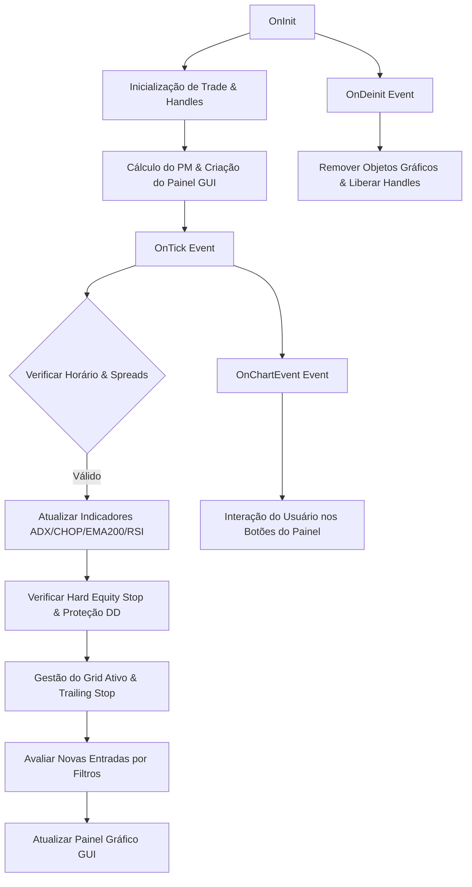

# 🏗️ Arquitetura Técnica - Burgo Scalpe Pro

Esta documentação descreve a arquitetura interna, os módulos operacionais e o fluxo de execução do **Burgo Scalpe Pro (V43)** em MQL5.

---

## 📌 Fluxo de Execução Ciclar

O ciclo de vida do EA no MetaTrader 5 é governado pelas funções nativas de eventos:

---

## 🧩 Módulos e Componentes Principais

### 1. Motor de Grid Progressivo e Gestão de Lotes
O robô opera com um sistema de **Grid Bidirecional Inteligente**, onde compras e vendas possuem acompanhamento independente.
- **Lote Inicial**: Definido por `InpInitialLot`.
- **Multiplicador de Lote (`InpLotMultiplier`)**: Aumenta geometricamente o tamanho do lote da ordem seguinte no nível do grid até atingir `InpMaxMartingale`.
- **Distância Progressiva (`InpStepMultiplier`)**:
  A distância base entre ordens (`InpBaseDistance * Point * PM`) se expande a cada nível adicionado, evitando acúmulo concentrado em fortes acelerações de preço.
- **Limite de Segurança**: O parâmetro `InpMaxTotalOrders` impõe um teto máximo de ordens abertas em simultâneo.

---

## 📊 Módulos de Filtragem e Análise de Mercado

O Burgo Scalpe Pro V43 combina **5 filtros técnicos concorrentes**:

| Filtro | Função | Regra de Execução |
|---|---|---|
| **EMA 200 Macro (`InpEMA200TF`)** | Filtro Direcional de Tendência | Preço acima da EMA 200 permite apenas **COMPRAS**. Preço abaixo permite apenas **VENDAS**. |
| **Choppiness Index (CHOP)** | Detecção de Consolidação vs. Tendência Explosiva | Se CHOP < `InpCHOPTrendLimit` (38.2), o mercado está em super-tendência direcional e novas ordens do grid são **PAUSADAS**. |
| **ADX Anti-Oscilação (`InpADXThreshold`)** | Força de Tendência | Se ADX < 20.0, o mercado está sem direção definida e o grid permanece pausado. |
| **ATR Dinâmico (`InpATRMultiplier`)** | Ajuste de Distância pela Volatilidade | Ajusta a distância entre ordens de acordo com a volatilidade média real das últimas barras. |
| **RSI Trigger (Opcional)** | Filtro de Exaustão de Preço | Exige RSI em sobrevenda (<30) para comprar e sobrecompra (>70) para vender. |

---

## 🛡️ Gestão de Risco e Proteção Financeira

1. **Hard Equity Stop % (`InpHardEquityStopPct`)**:
   - Monitora continuamente a porcentagem de drawdown flutuante em relação ao Saldo.
   - Se o Drawdown ultrapassar o limite (ex: 15%), o EA **fecha imediatamente todas as posições abertas** e reseta o ciclo.

2. **Fechamento por Lado (`InpTargetSideUSD`)**:
   - Sempre que o lucro acumulado das ordens abertas em um determinado lado (Buy ou Sell) atinge o alvo estipulado, o robô encerra aquele lado específico, liberando margem.

3. **Reset Global (`InpTargetGlobalUSD`)**:
   - Quando o lucro líquido total da conta atinge o alvo global, todas as posições são zeradas e o EA é reiniciado.

4. **Trailing Stop Dinâmico em Dólares**:
   - Ao atingir um determinado ganho flutuante (`InpTrailingStartUSD`), o robô acompanha a subida do lucro, encerrando a operação se houver retração superior a `InpTrailingDropPct`.

---

## 💻 Interface Gráfica Interativa (GUI Panel)

O painel visual é construído nativamente com objetos `OBJ_RECTANGLE_LABEL`, `OBJ_LABEL` e `OBJ_BUTTON` no MetaTrader 5 sob o prefixo `BSP_`.

### Funcionalidades do Painel:
- **Monitoramento em Tempo Real**: Exibe Tempo de Barra, Spread, Lucro Flutuante (Float), Saldo, Lucro Diário, Win Rate %, Drawdown % e Leituras de ADX/CHOP/RSI.
- **Botões de Ação Imediata**:
  - `BUY` / `SELL`: Ordens manuais a mercado.
  - `LIMPEZA`: Encerra posições lucrativas.
  - `PANIC`: Fecha absolutamente todas as ordens abertas.
  - `TOGGLES (ATR, ADX, CHOP, EMA, HEDGE)`: Permite ativar/desativar filtros em tempo de execução sem reabrir os parâmetros do EA.
