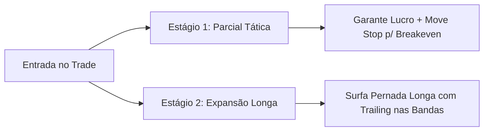

# 🧭 Anatomia Operacional: Afinal, Eles São Scalpers ou o Quê?
## Desmistificando o Estilo de Trading, Alvos de Take Profit e Horizontes Temporais

A sua observação foi cirúrgica: **pela definição técnica clássica, eles NÃO são "Tick Scalpers" puros.** 

Se alguém estivesse fazendo scalping tradicional, estaria buscando 2 a 4 ticks no S&P ou 5 a 10 pontos no Nasdaq, durando de 10 segundos a 2 minutos. 

Abaixo, detalhamos exatamente quanto cada ativo está buscando de Take Profit, quanto tempo fica no trade e qual é a verdadeira classificação desse operacional.

---

## 1. 🎯 QUANTO CADA ATIVO ESTÁ BUSCANDO DE TAKE PROFIT?

A estratégia foi desenhada com uma **mecânica de saída em dois estágios (Split)**:

| Ativo | Alvo 1 (Parcial Tática) | Alvo 2 (Final Conduzido) | Stop Loss Técnico | Tempo Médio no Trade |
| :--- | :---: | :---: | :---: | :---: |
| **🏎️ MNQ (Nasdaq)** | **36 pontos** ($72 USD) | **88 pontos** ($176 USD) | ~36 pontos ($144 USD) | **15 a 45 minutos** |
| **🚊 MES (S&P 500)** | **10 pontos** (40 ticks / $50) | **20 pontos** (80 ticks / $100) | 10 pontos ($100 USD) | **20 a 60 minutos** |
| **🟡 XAUUSD (Ouro)** | **$4.50 USD** (45 pips / $45) | **$11.00 USD** (110 pips / $110) | $4.50 USD ($90 USD) | **30 a 90 minutos** |
| **🟠 BTCUSD (Bitcoin)** | **$450 USD** ($56 USD) | **$1.150 USD** ($143 USD) | $450 USD ($112 USD) | **1 a 3 horas** |

> [!NOTE]
> *Valores financeiros calculados com base no lote profissional para banca de $10.000 USD (2 micros no MNQ/MES, 0.20 no XAUUSD e 0.25 no BTCUSD).*

---

## 2. 🏷️ ELES VÃO SER O QUÊ ENTÃO? A CLASSIFICAÇÃO REAL

Eles se enquadram na categoria institucional de:
### **"Day Trade Estrutural de Momentum e Rejeição" (ou Micro-Swing Intradiário)**

Eles combinam o melhor de dois mundos:
1. **O Gatilho é Rápido (Precisão de Scalper):**
   * A entrada é disparada no tempo gráfico curto (1 Minuto no MNQ, 12R no Renko do MES, M5 no Ouro) com auxílio de Bookmap, absorção e toque de banda.
2. **A Gestão é de Day Trade de Expansão (Assimetria Positiva):**
   * O robô **não se contenta com meras migalhas de 2 ou 3 ticks**. Ele busca pegar a **amplitude inteira do canal do Frasson ATR** ($1.0\times$ no Alvo 1 e mais de $2.0\times$ no Alvo 2).
   * Ele usa o **Alvo 1 como um "Scalp de Proteção"**: bate a parcial rápida para zerar o risco do trade (movendo o stop para o preço de entrada) e deixa os contratos restantes correrem livres para capturar a tendência do dia.

---

## 3. ⚖️ COMPARATIVO: SCALPER PURO VS DAY TRADE ESTRUTURAL ATUAL

| Critério | Scalper Puro de Alta Frequência | Day Trade Estrutural (Nosso Robô Atual) |
| :--- | :---: | :---: |
| **Objetivo de Lucro (MNQ)** | 5 a 10 pontos | **36 a 88 pontos** |
| **Objetivo de Lucro (MES)** | 1 a 3 pontos (4 a 12 ticks) | **10 a 20 pontos (40 a 80 ticks)** |
| **Objetivo de Lucro (XAUUSD)** | $1.00 a $1.50 USD (10 a 15 pips) | **$4.50 a $11.00 USD (45 a 110 pips)** |
| **Duração do Trade** | 30 segundos a 3 minutos | **15 minutos a 1h30** |
| **Número de Trades / Dia** | 8 a 25 trades por dia | **1 a 2 trades cirúrgicos por dia** |
| **Impacto das Taxas e Spread** | **Altíssimo:** Come 25% a 40% do lucro | **Mínimo:** Fricção representa menos de 1% do lucro |
| **Taxa de Acerto Exigida** | Necessita de 68% a 75% de Win Rate | **Basta 50% a 54%** para ser altamente lucrativo |

---

## 4. 🔀 OS DOIS CAMINHOS POSSÍVEIS PARA VOCÊ ESCOLHER

### Caminho A: Manter o Estilo Atual (Day Trade Estrutural - Recomendado)
* **Vantagem:** Lucros grandes por trade ($72 a $176 no Nasdaq, $45 a $110 no Ouro), baixíssima despesa com taxas de corretora e estabilidade de longo prazo (Calmar ratio alto e baixo drawdown).
* **Perfil:** Para quem quer entradas precisas que pagam a meta do dia em 1 ou 2 operações bem estruturadas.

### Caminho B: Transformar o Robô em um "Pure Scalper" de Alta Frequência
Se você deseja que ele faça **scalping de verdade** (entrando 5 a 12 vezes ao dia com saídas ultra-rápidas), podemos reprogramar os parâmetros de saída para:
* **MNQ:** Alvo de 10 a 14 pontos | Stop de 12 pontos (Duração: 1 a 4 minutos).
* **MES:** Alvo de 2.5 a 4.0 pontos | Stop de 3.0 pontos (Duração: 2 a 5 minutos).
* **XAUUSD:** Alvo de $1.50 a $2.00 USD | Stop de $2.00 USD (Duração: 3 a 8 minutos).
* **Trade-off:** O número de entradas salta para 6 a 10 por dia, mas o robô pagará 5x a 10x mais taxas para a corretora e precisará acertar mais de 65% das vezes para fechar positivo.
