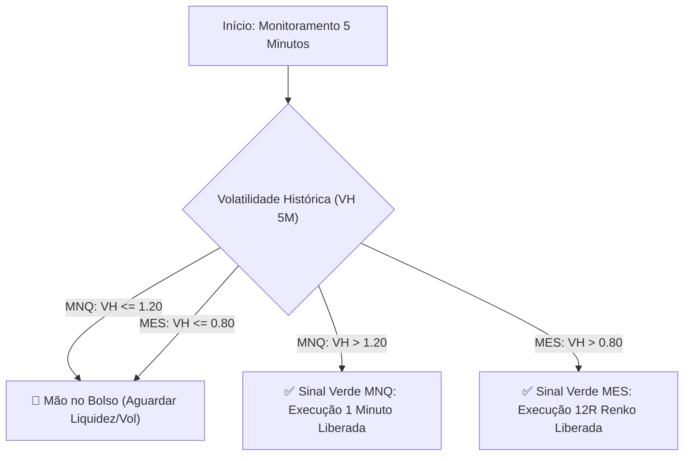

# 📊 Quadro Técnico Operacional: Micro Nasdaq (MNQ) & Micro S&P 500 (MES)

Este documento consolida a arquitetura operacional completa dos contratos futuros de **Micro Nasdaq (MNQ)** e **Micro S&P 500 (MES)**, detalhando os parâmetros técnicos, filtros de volatilidade, leitura de fluxo via Bookmap, regras de execução e gestão financeira.

---

## 1. 🧭 Mapa Macro de Direcionamento (GPS de Volatilidade)

O filtro de volatilidade é a **primeira linha de defesa** do sistema. Ambos os ativos exigem sinal verde na tela de **5 minutos** através da **Volatilidade Histórica (VH)**. Caso a VH esteja abaixo da linha de corte, **nenhuma operação é permitida** ("mão no bolso").

| Ativo | Tempo Gráfico do Filtro | Indicador | Limiar Mínimo (Gatilho Verde) | Ação se Abaixo |
| :--- | :---: | :---: | :---: | :---: |
| **MNQ (Nasdaq)** | 5 Minutos | Volatilidade Histórica (VH) | **$> 1,20$** | Bloqueio total de ordens |
| **MES (S&P 500)** | 5 Minutos | Volatilidade Histórica (VH) | **$> 0,80$** | Bloqueio total de ordens |

---

## 2. 🏎️ Especificação Operacional: Micro Nasdaq (MNQ)

* **Tempo Gráfico de Execução:** 1 Minuto (M1).
* **Indicador Base:** Frasson ATR (Período `14` | Deslocamento `5` | Parâmetro/Multiplicador `2.00`).
* **Gatilho de Entrada:** 
  1. Rompimento ou escoramento na banda do Frasson ATR de 1M.
  2. Alinhamento de absorção/pressão compradora ou vendedora no **Bookmap** (fluxo institucional).
* **Stop Loss Técnico:** Médio de **~36 pontos** (posicionado logo atrás da banda oposta do Frasson ATR de 1 min).
* **Alvo 1 (Parcial):** $1.0\times$ a amplitude do canal de entrada (**~36 pontos**):
  - Ao bater a parcial, a operação é imediatamente protegida no *breakeven* / zero a zero.
* **Alvo 2 (Final):** $2.0\times$ a $2.5\times$ a amplitude do canal (**~88 pontos**):
  - Condução dinâmica escorando pelas bandas do Frasson ATR.

### 💰 Matemática Financeira no MNQ (2 Contratos Micro)
* **Valor do Ponto:** $\$2.00$ por contrato (Tick de $0.25\text{ pt} = \$0.50$).
* **Risco Inicial (Stop Loss 36 pts):**
  $$36\text{ pts} \times \$2.00/\text{pt} \times 2\text{ contratos} = \mathbf{\$144.00\text{ USD}}$$
* **Retorno Potencial (Alvo 1 + Alvo 2):**
  - Contrato 1 (Parcial 36 pts): $36 \times \$2.00 = \$72.00\text{ USD}$
  - Contrato 2 (Final 88 pts): $88 \times \$2.00 = \$176.00\text{ USD}$
  - **Retorno Total Projetado:** $\$72.00 + \$176.00 = \mathbf{\$248.00\text{ USD}}$
* **Payoff Médio Efetivo:** $\frac{248}{144} \approx \mathbf{1.72\times}$ de assimetria positiva.

---

## 3. 🚊 Especificação Operacional: Micro S&P 500 (MES)

* **Tempo Gráfico de Execução:** Gráfico de Renko **12R**.
* **Indicador Base:** Frasson ATR (Período `14` | Deslocamento `5` | Parâmetro/Multiplicador `2.00`).
* **Gatilho de Entrada:** 
  1. Teste e rejeição de liquidez relevante visualizada no Bookmap (níveis com grandes ordens passivas ou absorções).
  2. Bloco 12R fecha contrário com **Cluster de POC no Pavio de Rejeição** (*trapped traders* encurralados).
* **Stop Loss Técnico:** Médio de **8 a 12 pontos** (ancorado atrás do pavio da POC de rejeição com $+1$ ponto de folga técnica).
* **Alvo 1 (Parcial):** **9 a 10 pontos** (captura do fluxo de liquidação forçada e *stop out* dos players encurralados).
* **Alvo 2 (Final):** **20 pontos** (alongamento nas pernadas longas de expansão do Renko).

### 💰 Matemática Financeira no MES (2 Contratos Micro)
* **Valor do Ponto:** $\$5.00$ por contrato (Tick de $0.25\text{ pt} = \$1.25$).
* **Risco Inicial Médio (Stop Loss ~10 pts):**
  $$10\text{ pts} \times \$5.00/\text{pt} \times 2\text{ contratos} = \mathbf{\$100.00\text{ USD}}$$
* **Retorno Potencial (Alvo 1 + Alvo 2):**
  - Contrato 1 (Parcial ~10 pts): $10 \times \$5.00 = \$50.00\text{ USD}$
  - Contrato 2 (Final 20 pts): $20 \times \$5.00 = \$100.00\text{ USD}$
  - **Retorno Total Projetado:** $\$50.00 + \$100.00 = \mathbf{\$150.00\text{ USD}}$
* **Payoff Médio Efetivo:** $\frac{150}{100} = \mathbf{1.50\times}$ de assimetria positiva.

---

## 4. ⚖️ Matriz Comparativa Consolidada

| Parâmetro | Micro Nasdaq (MNQ) | Micro S&P 500 (MES) |
| :--- | :---: | :---: |
| **Filtro Macro (5M)** | Volatilidade Histórica $> 1,20$ | Volatilidade Histórica $> 0,80$ |
| **Tempo Gráfico de Operação** | **1 Minuto (M1)** | **12R (Renko)** |
| **Indicador Técnico** | Frasson ATR (14, 5, 2.00) | Frasson ATR (14, 5, 2.00) |
| **Elemento Bookmap** | Alinhamento do fluxo na banda | Teste de liquidez + absorção |
| **Gatilho de Confirmação** | Rompimento / escoramento de banda | Bloco 12R inverso com POC no pavio |
| **Fenômeno Microestrutural** | Expansão de volatilidade em canal | Estouro de *Trapped Traders* |
| **Stop Loss (Pontos)** | ~36 pontos | 8 a 12 pontos (+1 pt folga) |
| **Alvo 1 - Parcial (Pontos)** | ~36 pontos ($1.0\times$ canal) | 9 a 10 pontos |
| **Alvo 2 - Final (Pontos)** | ~88 pontos ($2.0\times\text{ a }2.5\times$) | 20 pontos |
| **Lote Padrão** | 2 Micros | 2 Micros |
| **Risco Financeiro Total** | **~$144 USD** | **~$100 USD** |
| **Retorno Projetado Total** | **~$248 USD** | **~$150 USD** |
| **Risco / Retorno Efetivo** | **1 : 1.72** | **1 : 1.50** |
