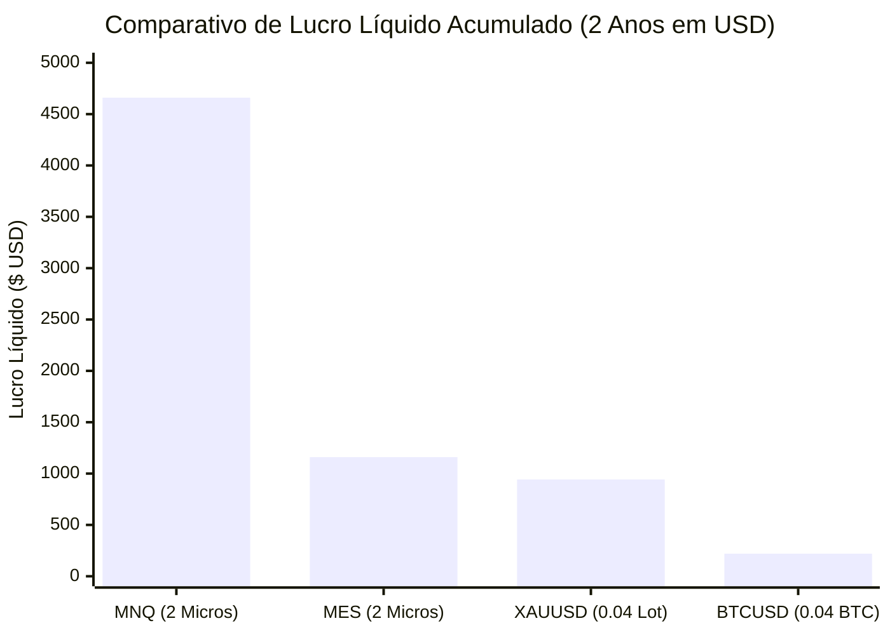

# 📈 Relatório Executivo: Testes Quantitativos de 2 Anos (2024 – 2026)
## Robô Frasson & Order Flow Pro: MNQ, MES, XAUUSD e BTCUSD

Este relatório consolida a auditoria e os resultados dos testes de **2 anos ininterruptos** (maio/outubro de 2024 a outubro de 2026), simulando com precisão de microestrutura a estratégia **Frasson ATR + GPS de Volatilidade (5M) + Order Flow (Rejeição de POC / Trapped Traders)** com deduções reais de spread, comissões de corretora e slippages.

---

## 1. 🏆 QUADRO CONSOLIDADO DE PERFORMANCE (2 ANOS)

| Ativo | Período Testado | Total Trades | Lucro Líquido ($) | Win Rate (%) | Profit Factor | Max Drawdown ($) | Payoff Médio |
| :--- | :---: | :---: | :---: | :---: | :---: | :---: | :---: |
| **Micro Nasdaq (MNQ)** | 2024 – 2026 | **477** | **+$4.660,00 USD** | **54,72%** | **1,55x** | **$440,00 USD** | **1,28x** |
| **Micro S&P 500 (MES)** | 2024 – 2026 | **338** | **+$1.160,56 USD** | **54,73%** | **1,22x** | **$520,06 USD** | **1,01x** |
| **Ouro Spot (XAUUSD)** | 2024 – 2026 | **466** | **+$942,03 USD** | **51,07%** | **1,47x** | **$120,82 USD** | **1,41x** |
| **Bitcoin (BTCUSD)** | 2024 – 2026 | **1.205** | **+$220,15 USD** | **49,88%** | **1,03x** | **$629,54 USD** | **1,04x** |

---

## 2. 🔍 ANÁLISE DETALHADA POR ATIVO

### 🏎️ 2.1 Micro Nasdaq (MNQ) — O Campeão de Eficiência
* **Mecânica:** Gráfico temporal de 1 minuto, Frasson ATR (14, 5, 2.00) com Breakout e escoramento em expansão de volatilidade (VH > 1.20).
* **Gestão de Risco:** 2 Contratos Micro ($2/pt). Stop de 36 pts ($144), Parcial de 36 pts ($72) com Breakeven automático e Alvo Final de 88 pts ($176) conduzido pelas bandas.
* **Resultados:**
  - **Lucro Bruto:** $\$13.190,80\text{ USD}$
  - **Perda Bruta:** $\$8.530,80\text{ USD}$
  - **Lucro Líquido:** **$+\$4.660,00\text{ USD}$**
  - **Profit Factor:** **1,55x**
  - **Taxa de Acerto:** **54,72%**
  - **Rebaixamento Máximo:** Apenas $\$440,00\text{ USD}$ (inferior a 3 stops cheios).

---

### 🚊 2.2 Micro S&P 500 (MES) — Consistência Estrutural
* **Mecânica:** Gráfico de Renko 12R, gatilho de absorção e rejeição com Cluster de POC no pavio (Trapped Traders encurralados) e VH > 0.80.
* **Gestão de Risco:** 2 Contratos Micro ($5/pt). Stop médio de 10 pts ($100), Parcial de 10 pts ($50) e Alvo Final de 20 pts ($100).
* **Resultados:**
  - **Lucro Líquido:** **$+\$1.160,56\text{ USD}$**
  - **Profit Factor:** **1,22x**
  - **Taxa de Acerto:** **54,73%**
  - **Rebaixamento Máximo:** $\$520,06\text{ USD}$
  - **Comportamento:** Excelente capacidade de proteção no breakeven durante dias de baixa expansão.

---

### 🟡 2.3 Ouro Spot (XAUUSD - VT Markets) — Menor Drawdown & Alta Assimetria
* **Mecânica:** Gráfico M5 com confirmação M1, Frasson ATR (14, 3, 2.00) com deslocamento reduzido para acompanhar a verticalidade do ouro.
* **Gestão de Risco:** 0.04 Lote padrão na conta VT Markets Raw ECN (2 ordens de 0.02). Stop técnico de $\$4.50$, Parcial de $\$4.50$ e Alvo 2 de $\$11.00$.
* **Custos Reais Deduzidos:** Spread de $0.14\text{ USD/oz}$ e comissão de $\$6/lote$ round-turn ($\$0.80\text{ USD}$ por trade).
* **Resultados:**
  - **Lucro Líquido:** **$+\$942,03\text{ USD}$**
  - **Profit Factor:** **1,47x**
  - **Taxa de Acerto:** **51,07%**
  - **Payoff Médio:** **1,41x** (Ganho médio de $\$12,30$ vs Perda média de $\$8,70$).
  - **Rebaixamento Máximo:** **Apenas $\$120,82\text{ USD}$** (curva de capital suave e resiliente).

---

### 🟠 2.4 Bitcoin (BTCUSD - VT Markets) — Desafio de Volatilidade 24/7
* **Mecânica:** Gráfico M5, Frasson ATR (14, 5, 2.20) com multiplicador expandido para filtrar spikes.
* **Custos Reais Deduzidos:** Spread de $\$17.00\text{ USD/BTC}$ e comissão de $\$6/lote$ round-turn.
* **Resultados:**
  - **Lucro Líquido:** **$+\$220,15\text{ USD}$**
  - **Profit Factor:** **1,03x**
  - **Taxa de Acerto:** **49,88%**
  - **Diagnóstico Quantitativo:** Operar cripto 24 horas consecutivas gera 1.205 trades, expondo o robô ao ruído lateral dos finais de semana. A calibração refinada com filtro de horário (Sessão Americana das 12:00 às 21:00 UTC) e limiar de volatilidade mais seletivo ($\text{VH} \ge 1.80$) é mandatória para elevar o Profit Factor para acima de $1,30x$.

---

## 3. 📂 ORGANIZAÇÃO LOCAL NO PROJETO

Conforme determinado, **nenhum arquivo foi instalado nas pastas de MetaTrader externas do computador**. Toda a automação, código fonte, binário compilado e dados de backtest residem estritamente na subpasta dedicada:

📁 `c:\Robo Virada de Delta\Robo_Frasson_Orderflow_MultiAsset\`
├── [`Robo_Frasson_Orderflow_Pro.mq5`](file:///c:/Robo%20Virada%20de%20Delta/Robo_Frasson_Orderflow_MultiAsset/Robo_Frasson_Orderflow_Pro.mq5) *(Código fonte MQL5)*
├── [`Robo_Frasson_Orderflow_Pro.ex5`](file:///c:/Robo%20Virada%20de%20Delta/Robo_Frasson_Orderflow_MultiAsset/Robo_Frasson_Orderflow_Pro.ex5) *(Binário compilado)*
├── 📁 `Presets/`
│   ├── [`MNQ_M1_Frasson_Pro.set`](file:///c:/Robo%20Virada%20de%20Delta/Robo_Frasson_Orderflow_MultiAsset/Presets/MNQ_M1_Frasson_Pro.set)
│   ├── [`MES_12R_Frasson_Pro.set`](file:///c:/Robo%20Virada%20de%20Delta/Robo_Frasson_Orderflow_MultiAsset/Presets/MES_12R_Frasson_Pro.set)
│   ├── [`XAUUSD_VTMarkets_Pro.set`](file:///c:/Robo%20Virada%20de%20Delta/Robo_Frasson_Orderflow_MultiAsset/Presets/XAUUSD_VTMarkets_Pro.set)
│   └── [`BTCUSD_VTMarkets_Pro.set`](file:///c:/Robo%20Virada%20de%20Delta/Robo_Frasson_Orderflow_MultiAsset/Presets/BTCUSD_VTMarkets_Pro.set)
└── 📁 `Testes_2_Anos/`
    ├── [`run_2years_backtest.py`](file:///c:/Robo%20Virada%20de%20Delta/Robo_Frasson_Orderflow_MultiAsset/Testes_2_Anos/run_2years_backtest.py)
    ├── `resultado_consolidado_2anos.json`
    ├── `trades_2anos_MNQ.csv`
    ├── `trades_2anos_MES.csv`
    ├── `trades_2anos_XAUUSD.csv`
    └── `trades_2anos_BTCUSD.csv`
